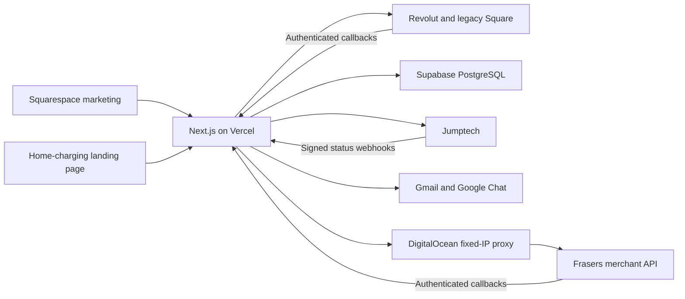

# VCHRGD D2C: incoming company handover

Prepared 21 October 2026. Read with [source provenance](SOURCE_PROVENANCE.md), [verification](VERIFICATION.md) and the [lifetime changelog](CHANGELOG.md). This guide describes recovered code and dated operational evidence; it does not certify a new live payment, restore exercise or load test.

## Architecture and scope

The platform sells installed Seven Pro EV chargers and manages the work after purchase. Squarespace supplies the main marketing website. The custom application owns estimates, discounts, payment sessions, customer progress links, additional balances, refunds, installer records, purchase orders, audit events and back-office reporting. Jumptech manages the external survey/installation project.

Hosted payment pages handle payment collection. The application stores operational customer/order data and provider references, not full card details. Main website content, Squarespace configuration and credentials are outside Git. Custom embeds supplied here are supporting source, not a complete marketing-site export.

## Skills and tool suite

| Discipline | Required knowledge |
| --- | --- |
| Full-stack development | TypeScript, JavaScript, React, Next.js App Router, server rendering, API routes and Node.js |
| Front-end and UX | HTML, CSS, Tailwind, responsive layouts, accessibility, SVG/assets and mobile/browser testing |
| Commerce integrations | REST/JSON, API authentication, signed webhooks, retries, idempotency, capture/refund lifecycles and reconciliation |
| Database operations | PostgreSQL/SQL, Supabase, JSONB state, concurrency, dedupe records and backup/restore |
| Cloud operations | Vercel, environment scoping, cron, DNS/TLS, DigitalOcean, Linux, SSH, Caddy and systemd |
| Google administration | OAuth, Cloud IAM, Workload Identity Federation, service-account impersonation, Workspace delegation, Gmail and Chat |
| Marketing operations | Squarespace, content/SEO, UTMs, campaign destinations, finance-promotion review and conversion reporting |
| Development operations | Git, npm/lockfiles, ESLint, TypeScript, automated testing, dependency security and controlled releases |

Supporting libraries include `pdf-lib`/fontkit for installer PDFs and Lucide icons. PowerShell, shell scripts and Node `.mjs`/`.cjs` scripts support operations. Assign an experienced technical owner alongside the marketing/content team.

## Accounts and ownership

The business should retain ownership/billing access, invite named agency users, and record primary and backup administrators. Transfer secrets through an approved password manager, separately from Git.

| System | Required access and responsibility |
| --- | --- |
| Git hosting | Private company repository `VCHRGD/vchrgd-d2c`; reviewer/collaborator access, branch policy and backup owner must still be agreed. No Vercel Git connection. |
| Squarespace | Site administration, code injection, CMS content, forms, domains and billing |
| Vercel | Team, both projects, environment scopes, logs, cron, deployment protection and billing |
| DNS | `vchrgd.com`, `vchrgd.app`, checkout/staging/proxy records, renewal and recovery |
| DigitalOcean | Droplet, SSH access, firewall, OS patching, services and snapshots |
| Supabase | Project, SQL access, connection ownership, backup/retention and restore procedure |
| Revolut | Merchant/API/webhook ownership, settlement and refunds |
| Frasers Plus | Merchant relationship, live/sandbox access, IP allowlist, callback registration and support contact |
| Square | Legacy transactions, callbacks and refunds; do not remove prematurely |
| Jumptech | Integration credentials, project/status mapping, webhook secret and operational support |
| Google Cloud/Workspace | OAuth client, Gmail identity, federation, delegated scopes and recovery |
| Google Chat / Trustpilot | Spaces/webhooks, membership and widget ownership |

Inventory credential consumers before rotating them; change one integration at a time and verify it. Preserve callback processing for in-flight transactions. Revoke outgoing access after a verified transfer.

## Environment map

Production: `payments.vchrgd.app`, Vercel project **`vchrgd-staging`**, ID `prj_OFRhCZfnOZseTdK1iAfFXoTqcUDZ`. Its name does not make it a test system. Separate staging: `staging.vchrgd.app`, project `vchrgd-frasers-staging`, ID `prj_qqcntEsa5JavYxkxSUR30k5AJhDj`.

Production source was checked on 21 October against `dpl_3717WEVxQ5Eg8n2djdoAs7u9uCoF`. Recheck the current alias before future work.

The Frasers proxy uses DigitalOcean's previously allowlisted address `143.110.170.126`. Its live service listens on loopback `3026`; Caddy exposes `/live/` at `frasers-proxy.payments.vchrgd.app`. A distinct sandbox service listens on `3025`. `/live/_state/*` must remain inaccessible. See [proxy guidance](../frasers-proxy/README.md).

## Customer and merchant workflows

1. Customer selects a charger and supplies installation/contact information. Server-side pricing calculates the authoritative estimate and eligible discount.
2. Customer chooses card or Frasers Plus; the server creates hosted checkout/approval and a signed return link.
3. Confirmed provider state, authenticated callbacks and reconciliation establish completion. A browser return or Revolut `AUTHORISED` event alone is insufficient.
4. Initial confirmed payment creates/synchronises a Jumptech project. Repeated events must not duplicate projects or notifications.
5. An opaque customer progress link shows survey/review and installation status. Jumptech updates arrive through authenticated webhooks.
6. Survey changes may require a separate balance transaction. Original finance approval does not imply top-up approval. Balance completion must preserve an existing booked/installed stage.
7. Booking, DNO approval where required, installer assignment, PDF purchase orders and dispatch are managed through the back office and Jumptech.
8. Refund controls distinguish recording an already completed external refund from actually requesting a provider refund. Never perform both for one payment.

Preferred-date selection was disabled for new cohorts from the September cutoff. Eligible historical workflows retain their policy; actual confirmed booking is separate. Do not bulk overwrite historical workflow state.

Orders with separately paid extras/replacement payments require external reconciliation rather than declaring a whole order refunded after refunding only one transaction. Pending/ambiguous outcomes need status checking and operator review, not blind retries.

## Scheduled jobs

Schedules in `vercel.json` use UTC. Successful execution depends on hosting, deployment and correct cron/integration configuration.

| Endpoint | Schedule | Purpose |
| --- | --- | --- |
| `/api/card-checkout/reconcile` | Every 5 minutes | Recover completed payments after missed callbacks/returns |
| `/api/checkout-recovery/send-due` | Hourly | Eligible checkout follow-ups; stop after payment |
| `/api/backoffice/stage-alerts` | Every 15 minutes | Overdue paid-order stage notifications |
| `/api/landing-analytics/cleanup` | Daily 03:20 UTC | Reporting retention and temporary-key cleanup |

Recovery supports 24/72-hour follow-ups subject to eligibility/configuration. Calling these endpoints manually with live credentials can reconcile real records or send real messages; use isolated fixtures for tests.

The Chat stage-alert transport was repaired on 29 September. An ambiguous result can retain a reservation and log `unconfirmed_delivery_requires_review`. Verify whether Chat received the alert before releasing its reservation. This trades automatic retries after uncertain delivery for avoiding duplicate messages.

## Routine maintenance

| Frequency | Work |
| --- | --- |
| Each working day | Check failed callbacks/5xx, reconciliation, notification failures, refund requests, unpaid extras, booking/DNO blockers and overdue paid jobs |
| Weekly | Review cron outcomes, failed email, account changes, checkout/landing metrics, hosting/database capacity and billing |
| Monthly | Assess dependency/security updates, OS patching, backups, product/finance copy, static landing prices and external links |
| Before release | Verify current source/configuration, test staging, run relevant regressions/build/security checks, review diff and identify rollback |
| At transfer and periodically | Exercise an isolated restore, confirm recovery access, service owners and incident contacts |

Provider dashboards are the source for transaction outcomes. Logs/exports may contain personal information; restrict access and retention and keep them out of Git and unsanitised tickets.

## Reporting and content

Landing statistics count aggregate page views, engagement and button interactions, with estimated bounce. They do not store persistent analytics visitor IDs in browser storage; the opt-out preference is remembered. Short-lived page/delivery keys support deduplication. GPC, Do Not Track and existing refusal are respected. Reporting totals are retained for approximately 90 days; temporary keys have separate short retention.

Repeated clicks count again. Landing clicks are not attributed completed sales and Squarespace activity is separate. Do not present these totals as a complete conversion funnel without an agreed attribution design.

Static landing prices and finance illustrations do not automatically follow every back-office price change. Review both together. The business/provider must approve substantive finance wording, APR illustrations, legal identity and claims.

## Backup, incidents and rollback

- Confirm the real Supabase backup/PITR plan, retention, access and restore owner. This task did not perform or certify a restore.
- Back up operational state and dedupe/receipt records consistently. Old state can reopen settled payments or resend messages; reconcile provider truth before resuming jobs after restoration.
- Include droplet services/configuration, DNS and securely stored secrets in recovery planning. Git contains code, not customer data or credentials.
- For a payment incident, collect non-sensitive IDs/timestamps/error categories and check provider outcomes before retrying. Keep callbacks/returns operational for in-flight transactions.
- For code regression, review and promote an appropriate previous deployment through the release process. A code/UI rollback must not restore old customer data or undo real refunds.
- Public Frasers flags can be baked into a build. An environment edit alone does not rewrite an existing deployment; hiding payment options must preserve callback handling.

## Priority maintenance finding at handover

**29 October candidate update:** the eight items from the [original review](CODE_REVIEW_2026-10-28.txt) are addressed in the verified repository candidate. The final lockfile audit reports **zero known vulnerabilities**; all eleven offline suites, lint, TypeScript and production build pass, and isolated PostgreSQL integration checks pass. These fixes have **not been deployed**. Provider-sandbox/Google staging acceptance and production promotion remain gated on access and release approval. See the [remediation record](REMEDIATION_2026-10-28.txt) and [validation](release-evidence/remediation-20261029/validation-results.json). The following paragraphs preserve the earlier handover snapshot; they do not describe this candidate's dependencies.

A fresh npm audit on 21 October reports **8 high-severity package findings** in the recovered dependency tree, including runtime Next.js/sharp and development/tooling dependencies. These are package/advisory findings, not eight independently proven exploitable application issues. The September zero-known-vulnerability result was historical and is no longer the current audit result.

See [audit evidence](dependency-audit-20261021.json). Plan a tested dependency/security update as an early maintenance change. No automatic fix or force upgrade/downgrade was applied: the production lockfile is deliberately preserved. npm's suggested major downgrade of lint tooling is not an approved migration plan.

## First-week acceptance checklist

- [x] Private company Git remote established; the original handover and later candidate history are preserved.
- [ ] Chapeau repository access explicitly granted and handover reviewed/shared. Production Git integration requires a separate release decision.
- [ ] Fresh checkout builds and synthetic tests run without production environment files.
- [ ] Every account has a named business owner, technical maintainer and recovery contact.
- [ ] Current aliases, project IDs, scoped settings, merchant IDs and callback registrations verified securely.
- [ ] Database backup and isolated restore verified; droplet recovery/fixed-IP arrangements documented.
- [ ] Staging payment returns, replay protection, top-ups, refunds, Jumptech and notifications tested with isolated services.
- [ ] Any separately authorised live transaction validation has an agreed scope, owner and reconciliation record.
- [ ] Finance/content approvals, release reviews and escalation responsibilities agreed.

No new live transaction was attempted during handover. Historical simulated assertions do not replace business acceptance of actual provider settlement and callbacks.
